# Lighthouse – Roter Sand bei jedem Wetter

Ein Leuchtturm auf offener See als 3D-Echtzeitszene: von der Sommerbrise bis zur Sturmnacht mit Gewitter und Leuchtfeuer, mit Tag und Nacht, Gezeiten, Innenräumen, Möwen, Schiffen und Klang. Vorbild ist der **Rote Sand** in der Außenweser, 1885 als erstes Bauwerk auf dem Meeresgrund errichtet. Das Besondere steckt nicht im Turm, sondern drumherum: Meer, Gischt, Wolken, Regen, Tropfen auf der Scheibe, Leuchtfeuer, Blitze, Nebel, Wetter, Möwen, Schiffe und Klang sind eigenständige Packages unter `com.dan`, die jedes spätere Projekt unverändert übernehmen kann. Die App ist ihr erster Anwendungsfall.

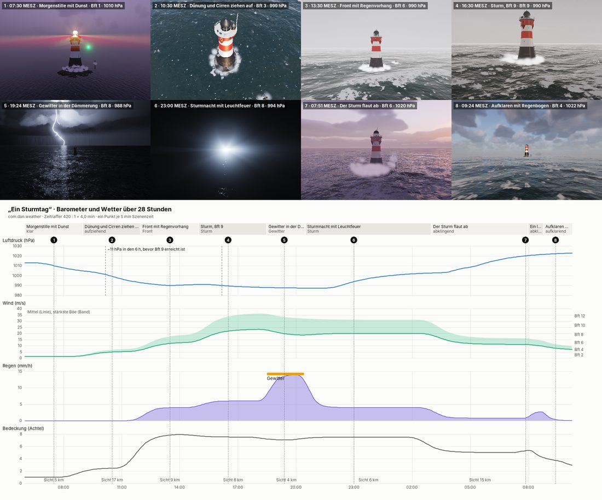

*„Ein Sturmtag“ im Zeitraffer: Morgenstille, Front, Sturm Bft 9, Gewitter in der Dämmerung, Sturmnacht mit Leuchtfeuer, Aufklaren mit Regenbogen.*

## Die Packages

Jedes Package folgt demselben Vertrag: Der Kern braucht nur Java 21 (`java.*`), der Ordner `gl/` dazu JOGL, der Ordner `demo/` dazu FStyle. Jedes hat öffentliche Felder als Eingänge, die Presets `calm()`, `breeze()`, `gale()`, `storm()` und `beaufort(n)`, einen `seed`, vier Qualitätsstufen, eine Demo mit `--bild` und eine Prüfklasse, die mit „Alles in Ordnung.“ endet.

**Seit Phase 17 kommen die Packages aus `lib/Renderer.jar`** (Sylt-Werkbuch F22 A, wie in Sylt und Brocken). Ihre Quelle ist das Projekt Renderer, dort übersetzt `check-packages` jedes Package einzeln; die Kopien, die bis Phase 16 in `src/com/dan` lagen, sind fort. Vorher wurden alle 374 Dateien der 21 Packages gegen den Renderer verglichen ([Prüfsummen](docs/status/Pruefsummen_Phase17.txt)): 290 gleich, 18 nur mit anderen Zeilenenden, 66 im Renderer weitergeschrieben (Brocken, Rungholt, Glacier, Haithabu, Sylt), keine nur in Lighthouse. Die eine Änderung, die Lighthouse voraus hatte – der Abgleich der Gischt über einen Pufferspeicher mit Zaun aus Avatar-Phase 19 (`SprayGl.selfCheckStart`/`selfCheckPoll`) –, ist in den Renderer zurückgeführt. Hier prüft `check-packages` jetzt `lib/Renderer.jar` (`tools/JarPruefung.java`: alle gebrauchten Packages mit README, Java 21, die Brecher aus `surf`) und übersetzt die eigenen Packages `avatar`, `gltf`, `hair`, `portrait` und `voice` einzeln (`tools/PaketPruefung.java`). Nach einem Neubau des Renderers: `dist/Renderer.jar` nach `lib/` kopieren.

| Package | Inhalt | README |
|---|---|---|
| `com.dan.ocean` | Windsee aus einem Spektrum (FFT auf der Grafikkarte), Dünung, Schaumköpfe und -straßen, Brandungsring (seit Phase 17 nur noch für Pfahl, Tonnen und Schiffe), Ringwellen; `heightAt` für alles, was schwimmt | Renderer: `src/com/dan/ocean/README.md` |
| `com.dan.sky` | Sonne, Mond, Planeten und Sterne nach Ort und Zeit, Streuung nach Hillaire, Dämmerung, Lichtglocken, Augenanpassung | Renderer: `src/com/dan/sky/README.md` |
| `com.dan.cloud` | Volumetrische Wolken in fünf Arten, Bedeckung in Achteln, Zug mit dem Wind, Schatten auf der See, Regenvorhänge | Renderer: `src/com/dan/cloud/README.md` |
| `com.dan.weathering` | Nässe nach Gezeit, Seegang und Regen, Rost, Algen, Salz, Moos | Renderer: `src/com/dan/weathering/README.md` |
| `com.dan.spray` | Schwälle an Wänden, Sprühnebel, Gischtfahnen, Weißwasser, Treffer auf die Nässekarte | Renderer: `src/com/dan/spray/README.md` |
| `com.dan.rain` | Streifen, Vorhänge, Ringe und Krönchen nach Marshall–Palmer und Atlas | Renderer: `src/com/dan/rain/README.md` |
| `com.dan.wetglass` | Tropfen auf der Scheibe: haften, laufen, verschmelzen, Beschlag, Salz, Überspülung, auch auf runden Flächen | Renderer: `src/com/dan/wetglass/README.md` |
| `com.dan.beacon` | Leuchtfeuer aus einer Kennung: Sektoren, Drehlinse, Strahl im Regen, Lichtpunkt am Horizont, Lichtflecken im Laternenraum | Renderer: `src/com/dan/beacon/README.md` |
| `com.dan.lightning` | Leitblitz in Stufen, Hauptschläge, Nachleuchten, Wolkenblitz, Donner aus dem Kanal | Renderer: `src/com/dan/lightning/README.md` |
| `com.dan.weather` | Die Regie: acht Lagen (dazu der Föhnsturm aus Glacier, den Lighthouse nicht nutzt), Markow-Kette, Trägheiten, Barometer, Regiebücher als Text | Renderer: `src/com/dan/weather/README.md` |
| `com.dan.fog` | Seenebel in Bänken, Licht im Nebel, Nebelschallsignale mit Kennung | Renderer: `src/com/dan/fog/README.md` |
| `com.dan.buoyancy` | Tonnen und ein Küstenmotorschiff auf beliebigem Wasser: Tauchen, Stampfen, Rollen, Lichter, Wischer | Renderer: `src/com/dan/buoyancy/README.md` |
| `com.dan.flock` | Silbermöwen: Schwarm, Aufwind, Landen gegen den Wind, Schlafen am Turm | Renderer: `src/com/dan/flock/README.md` |
| `com.dan.soundscape` | Erzeugter Klang ohne Audiodateien: Wind, Äolstöne, Brandung, Regen, Horn, Möwen, Donner, Diesel, Räume, Ohr | Renderer: `src/com/dan/soundscape/README.md` |
| `com.dan.kino` | Kinomodus aus Glacier: Regiebücher mit Balken, Vor- und Abspann, Untertiteln, Überblendung, Schwenk und Filmkorn | Renderer: `src/com/dan/kino/README.md` |
| `com.dan.tide` | Seit Rungholt: der Pegel aus zehn Partialtiden mit Spring und Nipp, Kalender, Windstau; hier `Tide.roterSand()` für die Gezeiten am Turm | Renderer: `src/com/dan/tide/README.md` |
| `com.dan.muster` | Die Vorlage für ein Element-Package | Renderer: `src/com/dan/muster/README.md` |
| `com.dan.surf` | Seit Phase 17 (aus Sylt): die Brandung am Caisson und an der Steinschüttung mit `Surf.sockel()` – Wellen Kamm für Kamm, Shoaling, Brechen nach McCowan, Brechertyp nach Battjes, Walze, Schaumteppich; der Grund je Reihe ist der Schnitt durch das Bauwerk | Renderer: `src/com/dan/surf/README.md` |
| `com.dan.lighthouse` | Die App: Szene, Verdrahtung, Renderer, Bedienfeld, Datenbank | [lighthouse](src/com/dan/lighthouse/README.md) |

Dazu liegen `forest`, `ground`, `river` und `road` aus dem Vorgänger Geyser im Jar; die App nutzt sie nicht.

## Brandung am Sockel (Phase 17)

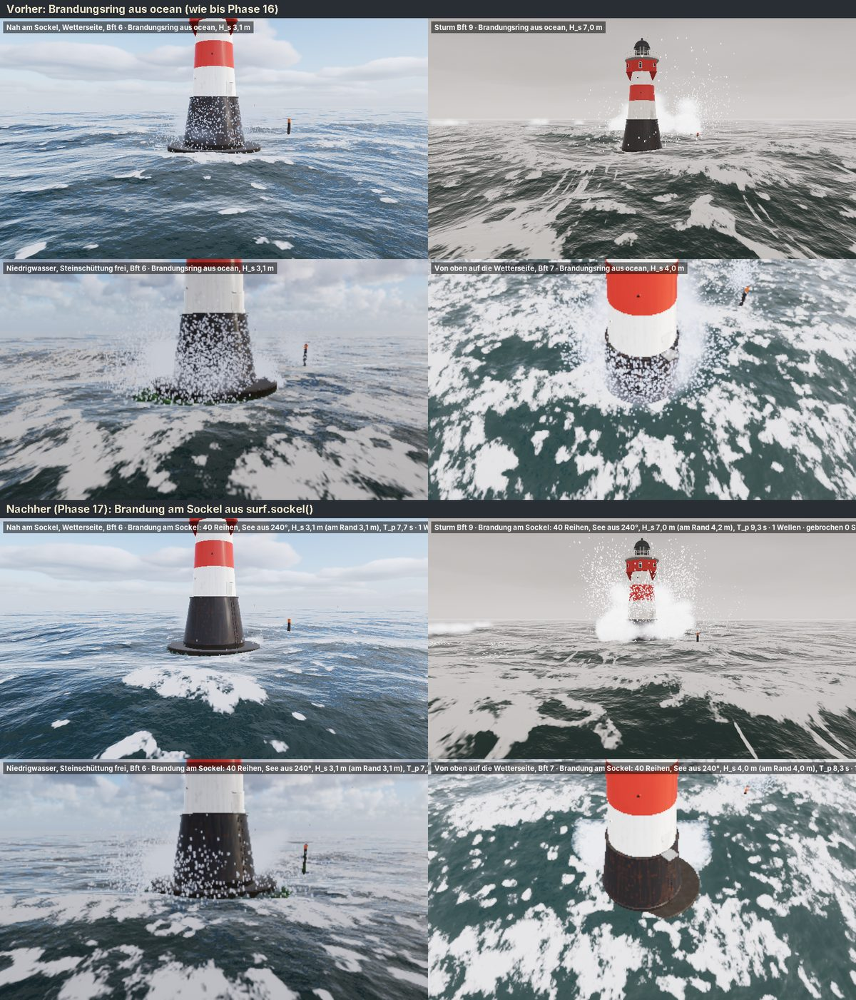

*Oben der Brandungsring aus `ocean` (bis Phase 16), unten die Brandung aus `surf`: dieselben vier Ansichten, Wind aus 240°.*

Bis Phase 16 lag um Sockel und Manschette ein Ring aus Schaum, den das Meer selbst zeichnete. Jetzt bricht die See an Caisson und Steinschüttung wie an einem Strand, nur steiler (`scene.Sockelbrandung`, Block GISCHT UND REGEN, Haken „Brandung am Sockel (surf)“):

- Ein Stück von 46 × 30 m um den Turm, längs der Laufrichtung der See. Darin laufen die Kämme gerade; jede Reihe hat ihren eigenen Grund, den Schnitt durch Seegrund (7 m [G]), Böschung, Steinschüttung, Manschette und Sockel an dieser Stelle (`WaveTrain.rowProfile`, neu im Renderer).
- Die Wellen brechen, wo die Schüttung flach wird – auf der Wetterseite zuerst, an den Flanken später. Auf dem steilen Hang meist als Reflexion oder Sturz (Battjes), kaum schäumend. Im Lee läuft eine niedrige Walze weiter.
- H_s am Rand ist tiefenbegrenzt (höchstens 0,55 · Tiefe [G]); draußen darf die See höher sein.
- Das Netz trägt die See: ruhiges Wasser taucht unter sie, das weiße Wasser reitet auf ihr. Am Rand geht es ohne Kante in sie über.
- Die Lippen der Sturzbrecher werfen Gischt (`spray.impact`). Jeder Brecher klingt.
- Der Ring aus `ocean` bleibt für Peilpfahl, Tonnen und Schiffe (`Obstacle(…, ring)`, neu im Renderer). Ohne Haken ist alles wie bis Phase 16.

Das Bild rechnet `tools.Brandungsbild` (mit `ring` als fünftem Argument das Vorher).

## Kino und Rückfluss aus Glacier

Ein Regiebuch lässt sich wie im Kino zeigen. Starten geht auf zwei Wegen:

- im Startbild: Regiebuch wählen, „Im Kino“;
- im Block WETTER unter „Regiebuch“: Haken „Im Kino zeigen“, dann „Starten“.

Bedienfeld, Statuszeile und Titelleiste verschwinden. Die Szene füllt den Bildschirm mit Balken auf 2,39 : 1, und es gibt:

- einen Vorspann mit dem Namen des Regiebuchs,
- Untertitel aus den Texten der Schritte,
- eine Überblendung bei jedem Wechsel der Kamera,
- einen langsamen Schwenk um den Turm,
- Filmkorn,
- einen Abspann, wenn das Regiebuch zu Ende ist.

Der Ton blendet mit dem Bild. **Esc** beendet das Kino (das Regiebuch läuft weiter), die **Leertaste** hält an, **F12** fotografiert mit Balken.

Mit dem Kino kamen die Erweiterungen der gemeinsamen Packages aus Glacier zurück:

- `sky`: der Südhimmel.
- `weather`: der Föhnsturm, eigenes Klima je App, Sommer auf der Südhalbkugel.
- `cloud`: die Lentikularis.
- `ocean`: Gletschersee (`Ocean.lago`).
- `buoyancy`: Eisberge, Treibeis, Katamaran.
- `flock`: der Andenkondor.
- `forest`, `ground`, `river`: von der älteren Fassung auf den Stand von Glacier (mit Lenga, Ñire, Guindo und dem Coirón).
- `soundscape`: Gletscher, Wildwasser.
- `spray`: Einschlag ohne Körper.

Alle Erweiterungen sind abwärtsgleich, ihre Vorgaben bleiben wie zuvor; Lighthouse übersetzt ohne eine Änderung an der App.

## Rückfluss aus Rungholt

Mit Rungholt (Phase 17, 20.10.2026) kamen zurück:

- `tide` (neu): die echte Tide am Turm. `scene.Tide` rechnet jetzt mit `com.dan.tide.Tide.roterSand()`: zehn Partialtiden des Pegels Bremerhaven, angepasst an 112 Hoch- und Niedrigwasser (20.10. bis 17.11.2026, nicht amtlich, im Mittel 10 min genau), eine Stunde früher, Hub 3,0 m im Mittel [G]. Spring und Nipp sind damit kräftiger als mit den drei Teiltiden vorher: Nipp rund 2,0 m, Spring bis 3,8 m; bei Springniedrigwasser ragt die Plattform des Caissons fast 2 m aus dem Wasser (vorher rund 1,5 m).
- `weather`: der Orkan aus Westnordwest (`Phase.ORKAN`), den die Standardkette nicht erreicht; Tabellen mit weniger Zeilen bleiben gültig.
- `ocean`: Strömung als Textur, weicher Rand der langen Welle, Grund außerhalb des Rechtecks, gegen das Kachelmuster (alles abgeschaltet, solange die App es nicht setzt).
- `flock`: die Wattvögel (`Waders`, sieben Arten) neben den Möwen.
- `buoyancy`: die Kogge, `Mesh` mit mehr Formen.
- `ground`: Deich, Salzwiese und Marsch der Nordsee.
- `soundscape`: Watt, Priel und Sturmnacht (`Wadden`, `Stream`).
- `kino`: nur die README.

Dabei fiel ein alter Fehler auf: `db.Startdaten.wetterlagen()` lief seit dem Föhnsturm aus Glacier über das Feld der acht Namen hinaus. Die Schleife nimmt jetzt nur die Lagen mit Namen.

## Rückfluss aus Timmendorf (Phase 18)

Mit Timmendorf (Phase 18, 31.10.2026, F29 A) kamen zwei Packages neu dazu:

- `cloth`: die **Bundesflagge** (1,2 × 0,72 m) am Mast auf der Galerie, Tuch nach XPBD im Wind 10 m über dem Wasser mit Höhenprofil und Böen, nass im Regen (`scene.Aussenlicht`).
- `lamp`: **Leuchten außen** mit Dämmerungsschalter (an unter 35 lx): eine Arbeitsleuchte über der Tür (LED 4 000 K, 1 500 lm nach unten, rund 110 lx auf dem Podest) und das rote **Hindernisfeuer** an der Mastspitze (32 cd rundum). Ihr Licht fällt über `lamp.glsl` im Turm-Shader auf Mauer, Stahl und Leiter (ohne Schatten), das Hindernisfeuer auch als Punktlicht auf die See, beide als Lichtpunkt mit Dunst und Nebel ins Bild [G: der Rote Sand hatte außen nur das Feuer].
- `ant renderer` holt das neue `Renderer.jar`; mit `-Drueckfluss=aus` bleibt alles wie in Phase 17 (`ant vergleichsbild -Dstand=zwischen -Drueckfluss=aus`).

## Bilder

| | |
|---|---|
| 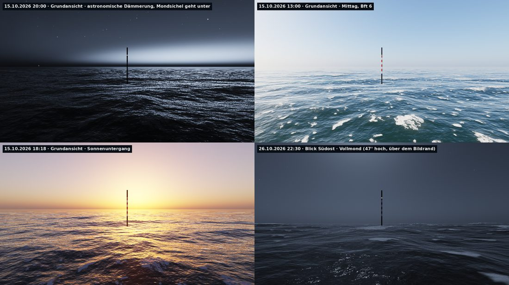 Morgen, Mittag, Abend und Nacht aus `com.dan.sky` | 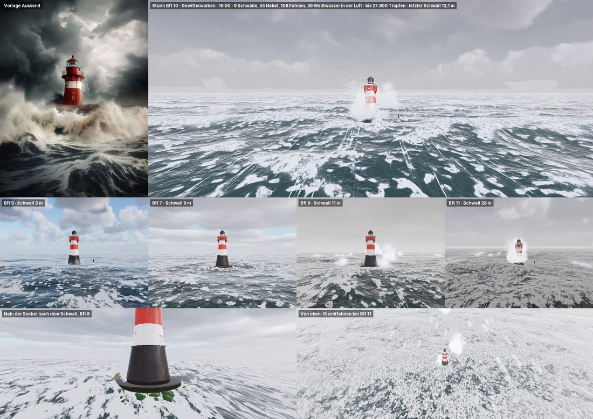 Gischt an Manschette und Sockel, Bft 6 bis 11 |
| 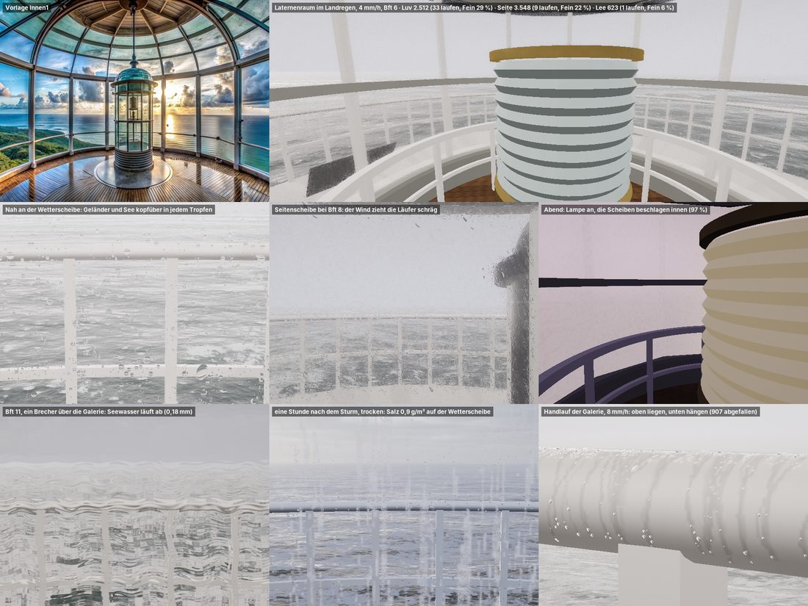 Tropfen auf den Scheiben des Laternenraums | 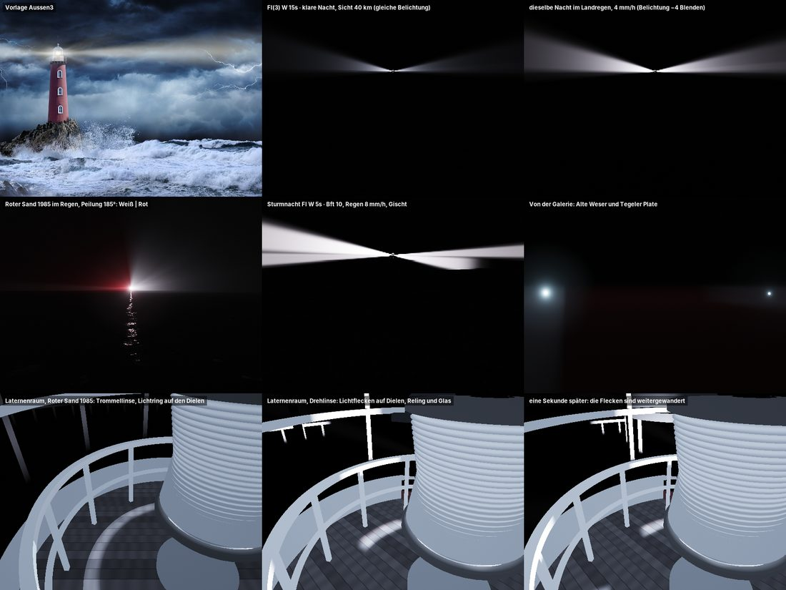 Das Feuer von 1985 mit Sektoren und der Strahl im Regen |
| 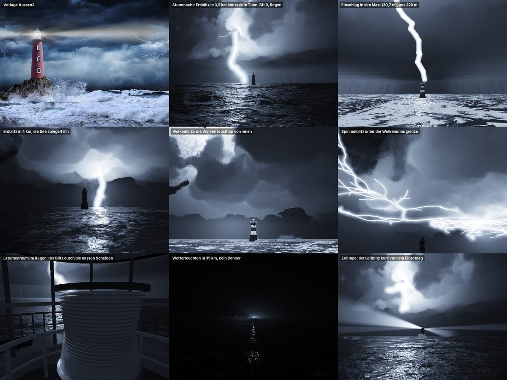 Gewitter: Leitblitz, Schlag in den Turm, Wetterleuchten | 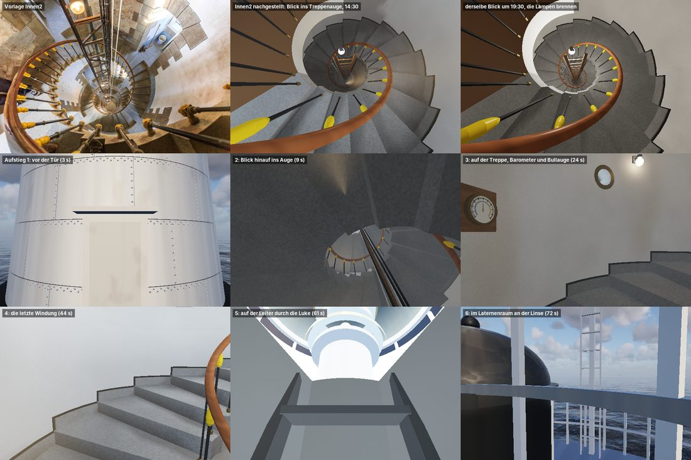 Die 59 Stufen und der Dienstraum, Licht durch die Bullaugen |
| 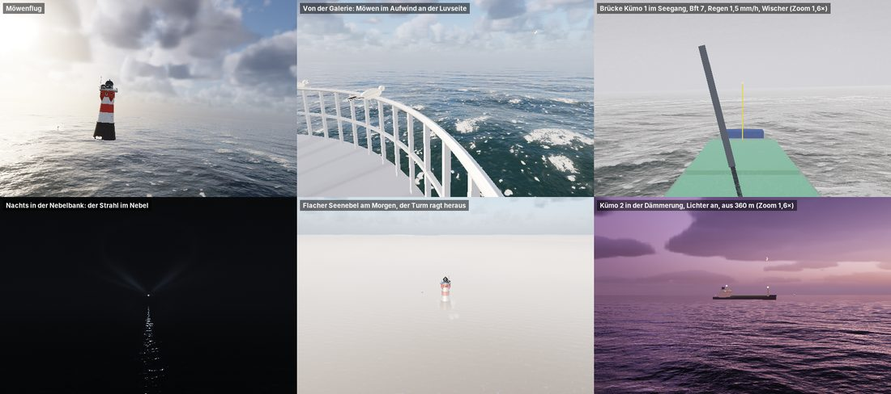 Möwen, Schiffsbrücke im Seegang, Nebelbank mit Strahl | 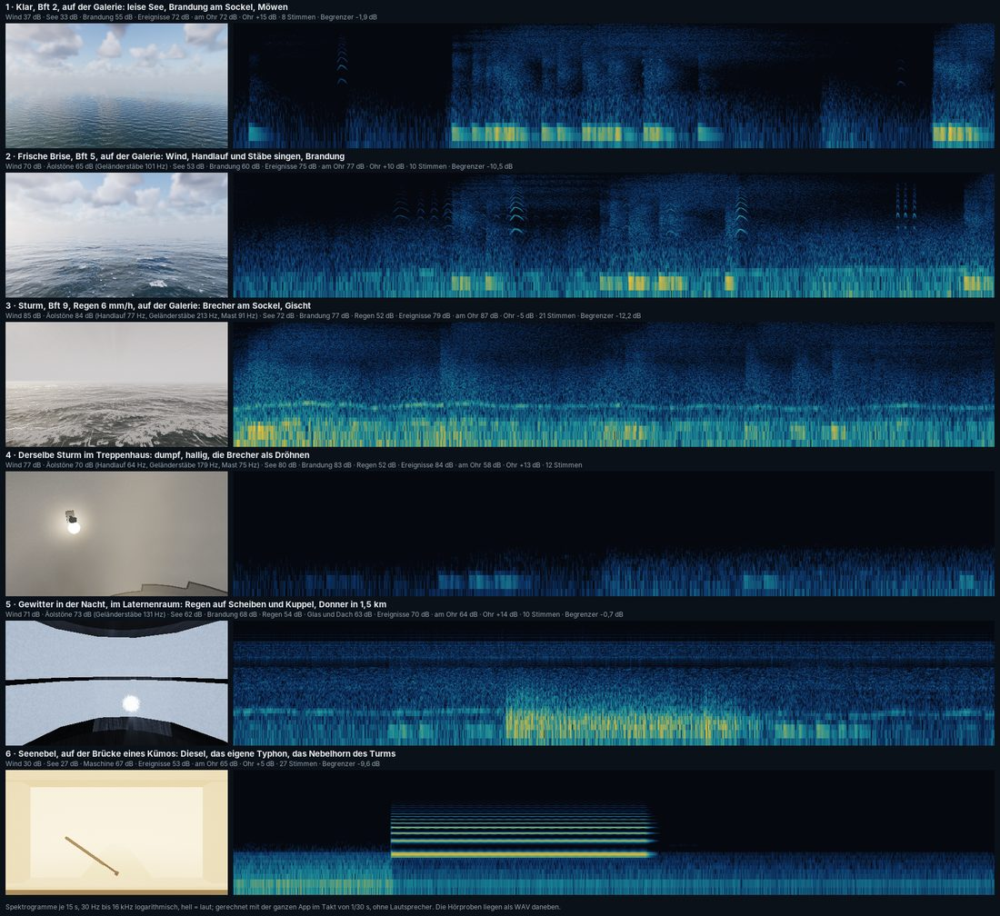 Sechs Hörproben als Spektrogramme |
| 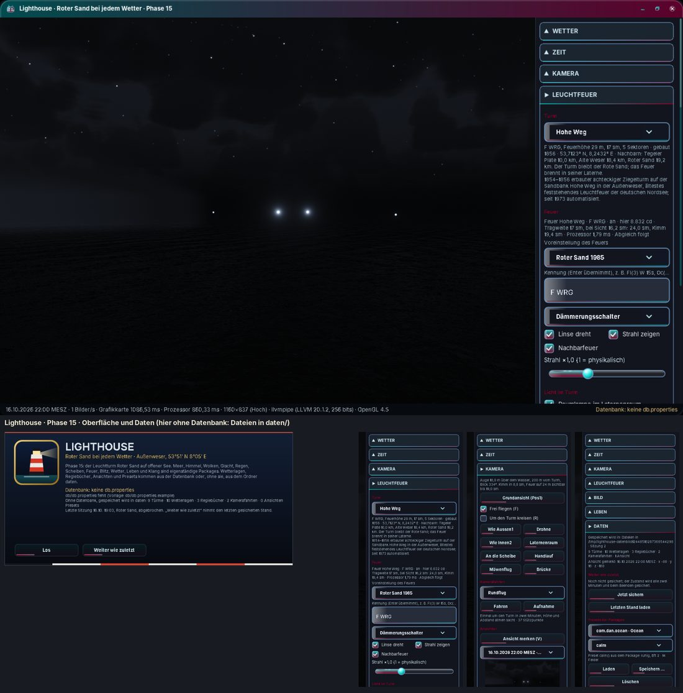 Turmauswahl, Ansichten, Datenbank | 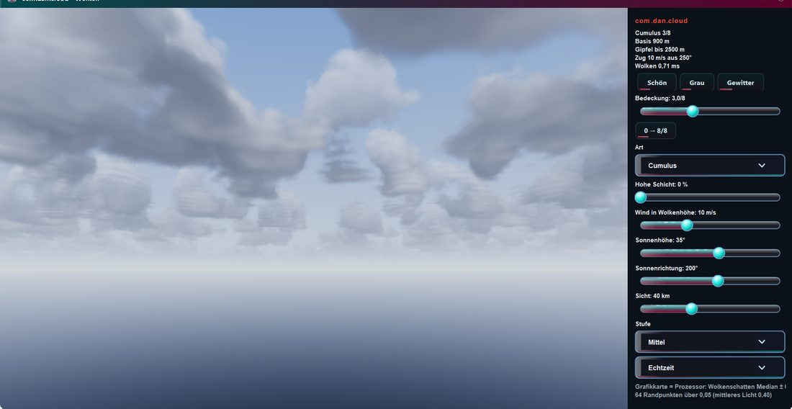 Die Demo von `com.dan.cloud` |

Weitere Demobilder: [Gischt](docs/bilder/gischt_demo.jpg), [Leuchtfeuer](docs/bilder/leuchtfeuer_demo.jpg). Die Statusbilder jeder Phase liegen in `docs/status/`.

## Bauen und starten

- NetBeans-Projekt mit Ant, JDK 21. In `lib/`: `Renderer.jar` (seit Phase 17, aus dem Projekt Renderer), JOGL 2.6.0 mit Windows-Natives, `FStyle.jar`, `ojdbc11.jar`, `sdoapi.jar`.
- **Clean and Build** erzeugt `dist/Lighthouse.jar` mit `dist/lib`. Danach startet `Lighthouse.bat` die App ohne NetBeans, und `Verknuepfung.bat` legt eine Verknüpfung mit dem Programmsymbol (`icon/lighthouse.ico`, Goldkante) auf den Desktop.
- Voraussetzung: OpenGL 4.3 mit Compute-Shadern. Beim Start prüft die App das (`ComputeProbe`); das HUD zeigt Bilder/s, die Zeit jedes Durchgangs und den Abgleich Grafikkarte = Prozessor.
- Ziel: AMD Radeon 680M (2 GB). Dort läuft „Hoch“ mit 60 Bildern/s in 1520 × 940; die Auflösung regelt sich bei Bedarf von selbst.
- Tasten: F1 zeigt die Übersicht. 1–9 setzen die Ansichten, Leertaste hält die Regie an, V merkt die Ansicht, F11 zeigt nur die Szene, F12 macht ein Foto.

## Datenbank

Oracle 21c, Schema `LIGHTHOUSE` auf PDBORCL, Präfix `LH_`, Spatial mit SRID 8307. Zugang in `db/db.properties` (Vorlage `db/db.properties.example`). Der Einrichter in der App legt die 13 Tabellen, Sichten und Startdaten an (`db/sql/`); `test/…/DbPruefung` prüft alles und endet mit „Alles in Ordnung.“ Ohne Datenbank läuft die App genauso und speichert in `daten/`. Mehr in [db/README.md](db/README.md).

## Prüfen

- `Pruefung` (Ant-Target `pruefung`): fast 800 Prüfungen ohne Grafikkarte und Datenbank (die Prüfklassen der Packages laufen aus `Renderer.jar` mit).
- Jedes Package: `…Check` endet mit „Alles in Ordnung.“, `…Demo --bild` schreibt sein Standbild.
- `tools.Dauerlauf 30` (Ant-Target `dauerlauf`): die Szene läuft 30 Minuten ohne Fenster durch Tage, Türme, Stufen und Regiebücher, seit Phase 17 schaltet sie dabei die Brandung am Sockel um, und endet mit „Dauerlauf bestanden“.

## Quellen

Vorbild, Vorschriften und Veröffentlichungen stehen in [docs/QUELLEN.md](docs/QUELLEN.md). Was gestaltet oder geschätzt ist, trägt das Zeichen [G]. Das Werkbuch mit Plan, Entscheidungen und Fortschritt je Phase liegt als Artefakt „Lighthouse Werkbuch“ vor.
